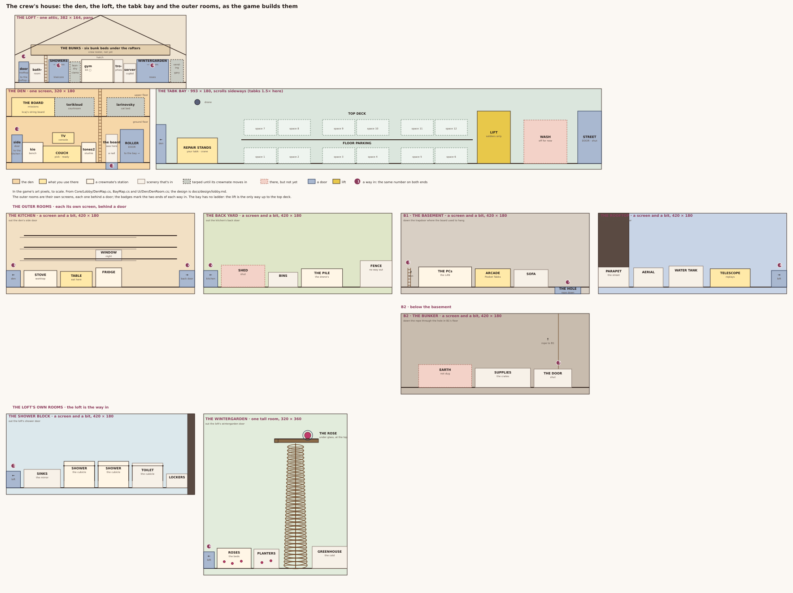

# The lobby: the gaming den

Where you pick your soldier and ready up, solo and in co-op: the inside of the crew's hangout, with a station for every freed crewmate, who lives there between missions.

**Status:** approved by the owner, 2026-10-16 (second pass): the owner liked the first ("the bits feel good. I like the writing") and asked for the big screen, a GameCube-style console, and picking by sitting on the couch. First pass from the owner's note on the Roadmap: "The lobby should be the interior of the gaming den base, every playable character has a station and occupies it once they become playable. Small animation cycles of them interacting with their stations or with other players on the screen, sometimes with funny dialogue". All the lines are placeholders for the owner to rewrite in the crew's own voice.

**Built:** the den itself is in the game, approved by the owner (2026-10-16): the room, tones2's and kie's stations, the bits, picking on the couch, READY and the zoom, and the co-op seats and countdown. The TV shows the co-op room's name, TAP TO INVITE (it shares the game's link) and how many are watching. The first-visit and move-in beats are built too (den-beats-build, 2026-10-19). Not yet: the couch fist bump, and the host changing the mission.

**Read this when** you're building the lobby, the crew screen, or a new crewmate's station.

Up: [Design](README.md)

Concept: `concepts/lobby/den-lobby.png` in the project's files (second pass; the first is `den-lobby-v1.png`).

## Den 2.0: the den and the long loft

**The house map** ([lobby/house-layout.svg](lobby/house-layout.svg), drawn by [lobby/house.py](lobby/house.py) from what the game builds: `DenMap`, `BayMap` and the den's stations; owner, 2026-10-21) is the canonical layout: when a room moves in the game, redraw it. It covers the den, the loft and the tabk bay, and the [outer rooms](#the-outer-rooms) the house grows into.

**Layout picked by the owner on 2026-10-18** (den2-layout, layout C: https://claude.ai/artifact/98a63GBzVDfhSL9SQN71tY). One screen can't hold eight crew, so the den grows past it. Where this section and the rest of the page differ, this section wins; the rest still holds for the den screen itself.

**Not in the game yet:** the den in the game is still the one-screen room below ([the room](#the-room)). Den 2.0's art is picked (den2-art), and building it is its own card.

- **The den stays one screen,** the painting below with the loft railing gone: the couch, the TV and console, the mission board, kie's bench and tones2's slushie. Picking, readying and starting a mission never needs a scroll, and the crew you'd swap to are close by.
- **The loft is a short walk up the ladder,** about 1.2 screens wide (382 × 164, den2-loft-rescale, picked 18 Oct): drawn to the soldier's scale, every room fits in that width, and the camera rises with you and pans the little extra. The ladder's top pokes out of a hatch at the gym (about x 190 in the loft), right over the den's ladder. Left to right: the outdoor door to the rooftop at the far left (weathered, a night-sky window, a lit EXIT sign), the bathroom, a short ladder up to the bunks, the shower block and the laundry; the gym and the trophy wall around the hatch; the server cupboard, the wintergarden and the vending machine. **The bunks are in the roof:** a plank platform on the tie beam across nearly the whole loft, open only over the gym's hatch, with the crew's bunk beds (three on the left, three on the right) and lamps under the rafters, up its own short ladder beside the bathroom. It's one open attic, with no walls between the rooms. Rooms behind a tarp stay tarped, one corner ripped as a clue, until the crewmate who brings them moves in.
- **Scale:** everything is drawn for the 22 px soldier. A door is about 37 px tall (1.7 times him), a ladder rung about 4 px, a trophy about 7 px, and he stands upright on the bunk platform under the beam. A painting that comes back bigger is shrunk in code until its doors are 37 px (the model won't paint small), and the den's build checks each floor's doors and ladders against the soldier's height.
- **The art** (den2-art, picked 18 Oct, page https://claude.ai/artifact/WfN5uKuS425N5hJdgQYULW), in `/mnt/project-files/concepts/den2/`: the den is `den-master.png` (320 × 180) with its full-size `-raw` painting. The loft was repainted at the soldier's scale (den2-loft-rescale, page https://claude.ai/artifact/GzJBQu4xYeFYHjX2ar5o5a): it is `rescale/loft-attic.png` (382 × 164, 64 colours) and `rescale/loft-attic-raw.png`, and its moved-in layers are `rescale/layers/<name>-picked.png` (with `-picked-raw`). The old three-screen `loft-master.png` and its loft layers are retired; its den layers stand. `layers/` (the loft's now in `rescale/layers/`) holds what changes once a crewmate moves in, each a full plate with only its own area changed (`<name>-open-picked.png`, with `-raw` paintings): in the loft, the shower block (kiwicore: the tarp tied back), the laundry (ciarra: her sewing table and a drying rack) and the wintergarden (the tarp gone, roses and a rose under a glass dome); in the den's upper floor, kcaj's dark string-board nook on the left, torikloud's courtroom in the middle (gavel, law books, two eggs) and larinovsky's cat bed right of the ladder. Until then those corners stay tarped as in the master.
- **The outer places are their own screens,** through a door: the kitchen (a side door, and the back yard out its back door), the tabk bay (the roller door), the basement down a trapdoor in front of the couch (the bunker beyond it, dug later), and the rooftop out the loft's far-left door. The tabk bay opens with the den, after Mission one; most of the others come after Mission two ([den2-story](https://claude.ai/code/artifact/f6915f40-b462-4063-8250-a8c245d35353) says what each is for). Each room is its own screen, entered through a door, and the numbered badges on the map mark the two ends of each way in.
- **Walking to a station is the menu.** The soldier you play is the one you move: tap the floor to walk, tap a station or a door to walk there and use it (keyboard and gamepad: left and right walk, up and down take ladders and doors, jump uses). The couch is ready; the mission board is mission select; the gym is the kit screen (moves and how to play); the bunks in the roof the crew roster; the trophy wall your rank and stats; the laundry and shower block looks; the tabk bay tabks; the rooftop telescope replays; the vending machine the shop, once gary opens it; the basement arcade a link to Pooket Tabks.
- **Shortcuts:** READY (bottom right) runs your soldier to the couch and sits; a MAP button (top right) shows the house as a cut-away, tarped rooms greyed, and tapping a room takes you there with a quick cut. BACK stays top left and nothing is tappable in the bottom corners.
- **Swapping crew** (an Idea, den2-group-chat): a laptop on kie's bench opens a group chat; tap a crewmate's name and your soldier messages them to come to the GameCube, they answer in character, walk in from the side door or down the ladder and take the couch.
- **Co-op:** each phone follows its own soldier, and the partner walks around the den too.

### The tabk bay

**Layout picked by the owner on 2026-10-19** (den2-tabk-bay, layout A3; page https://claude.ai/artifact/Ru5NGudKFxkVZWydXLHoNi). It's the outer room through the den's right roller door: a long garage where the crew's tabks live, its own screen that scrolls sideways.

- **Left to right:** the roller door back to the den; the repair bay, with an overhead crane over a tabk on stands; a ladder up to the top deck; the parking, two decks of six spaces each (twelve tabks); the lift right against the top deck's end, a vertical-compactor platform that carries soldiers between the decks (not tabks), with a hazard-striped landing at deck height and a column down to the floor; the drive-through wash; and the street door, which stays shut: tabks reach a mission by the call-in. The crew's cargo drone lives in the bay and waits over the repair bay.
- **Scale: tabks are drawn 1.5 times bigger here,** each tabk's own sprite scaled up (tones2's 52 × 22 becomes 78 × 33, kie's and kcaj's 52 × 28 become 78 × 42) beside the 22 px tall soldier, the ratio the boss fight has, so they read as vehicles you stand beside. Missions and boss fights keep the 52 × 22 sprite. Doors stay about 37 px, as in the den.
- **Your tabk is the one on the repair stands** (owner, 2026-10-19, tabk-select-design; page https://claude.ai/artifact/51JWmMUNBg98HsDe7wKSU1): walk in from the den and you see at once which tabk you have loaded. While it waits it's being refuelled and tuned: a fuel hose from the wall, a gauge filling, a spark at the engine now and then, its engine ticking over with the lights on. tones2's is there first; kie's parks downstairs, back after Mission one too (owner, 2026-10-20).
- **Picking another:** walk to a tabk and tap it for its card (its name in its crewmate's colour, its three guns and their rounds); TAKE IT sends the cargo drone to swap them. It unhooks the fuel hose, lifts your old pick off the stands and lowers it into its parking space, fetches the new one and sets it on the stands, and the hose goes back in (about ten seconds; tapping again skips to the end, and you can walk off while it plays). The loaded tabk's card says LOADED. A top-deck tabk is picked up there: the soldier rides the lift. Tabks not yet won sit as empty spaces, with the bay filling as they're freed.
- **The drone's idle:** with nothing to do, now and then the drone picks up a parked tabk and moves it to another free space on its deck.
- **The drive-through wash** is switched off for now: a later unlock that gives a tabk bonus armour, on its own card when it's queued. The crane over the stands is scenery; the drone does the lifting.
- **Co-op: one of each tabk** (owner, 2026-10-21, unique-crew-pick). Each player picks in their own bay, as the den works, but a tabk your partner has loaded is taken: it stays in its space, dimmed, with your partner's P1 or P2 tag, and its card says TAKEN instead of TAKE IT. If you both arrive with the same tabk loaded, or tap TAKE IT on the same one at the same moment, the rule is the couch's: whoever's in the mission keeps it, else the host. The other player's drone swaps in their next won tabk, in bay order, and the card says who has theirs. Every co-op player has beaten Mission one, so each has at least two tabks and one is always free.
- **The art** (picked 19 Oct), in `/mnt/project-files/concepts/den2/tabkbay/`: `bay-plate.png` (993 × 180, 64 colours, the floor line at 168) with its 4x painting `bay-plate-raw.png`, and `bay-plate-check.png` with the sprites placed. It's Seedream pieces joined in code, the ends colour matched, and the join between the top deck and the lift repainted by a fill edit (fill 3, in `fill/`). The earlier join is kept as round 2 on the page.
- **Built** (tabk-select-build): the bay opens with the den, after Mission one, with tones2's tabk on the stands; kie's and kcaj's are won by beating Mission two (kie's moves to after Mission one, with his homecoming beat, in kie-tabk-home-m1). A tabk you've won stays won, and every tabk drops into a mission as itself (owner, 2026-10-20, tabk-unlock-vs-built); the bay cards' old "MISSIONS DROP TONES2'S FOR NOW" note goes in bay-card-note. The painting has no ladder to the top deck, so the lift is the way up. The den's roller door rolls up as you reach it and you step through under it; back out of the bay, it rolls down behind you (owner, 2026-10-19). Code: `BayMap`, `Garage` and `RollerDoor` in Core, `BayFlow`, `BayView`, `DenRollerDoor`.
- **Raid night** (the opening) can reuse this plate with a mess layer over it, made on the card that needs it.

## The outer rooms

**The house grows outward** (owner, 2026-10-21): each of these is **its own screen, reached through a door**, like the tabk bay. The map at the top of this page is the canonical layout: the numbered badges mark the two ends of each way in, and the same number is on the door in the house and the door in the room. All of them are open, so the whole house can be looked at.

- **The kitchen** is out the den's **side door**, on the ground floor's left end (where the board used to be, the wall is bare with a nail in it). A worktop with the stove, a table to eat at, the fridge, a window over the sink, and empty shelves all along the wall above the worktop. Its **back door** leads to the back yard.
- **The back yard** is out the kitchen's back door: the shed (shut), the bins, the pile the drone makes of the tabks it moves, and the fence at the end with no way out of it.
- **The basement** is down a **trapdoor in the floor**, on the ground floor's right end. It's **two levels**:
  - **B1 is a gaming den**: a big room with the PCs set up along the wall (a LAN), the arcade, and a sofa. The far end is **the hole**, dug through the floor later in the game.
  - **B2 is the bunker**, below: reached down through that hole, with the supplies in crates and a door that stays shut. The earth round it isn't dug out yet. Its way in and out is the **rope** that hangs from the hole in its roof: you climb **down** it when you arrive and **up** it to leave.
- **The rooftop** is out the **loft's far-left door**: the telescope (which replays the missions), the water tank, the aerial, and the parapet over the street. The roof **ends at a wall**: the far side of the deck is closed off, so it never looks as though there is more roof to walk on.
- **The loft's own rooms are the loft's way in:** the **shower block** is out the loft's shower door, with sinks and a mirror along one wall and shower and toilet cubicles behind **swinging saloon doors**; the room **ends at a wall** past the lockers, so they look against a wall rather than cut off. The **wintergarden** is out the loft's wintergarden door, and it's a **tall room** (320 × 360: one screen across, two up) with a **spiral staircase** turning up the wall to a **landing** at the top, where **the rose** waits under its glass dome. The stair's treads are a step apart, for the 22 px soldier to climb. The rose is out of reach from the floor: **you have to climb the stair to see it**, and the camera rises with you. The landing is **wide enough for two crew to stand on it**, so a cutscene can happen up there.
- **The mission board moves up to kcaj** (owner, 2026-10-21): **the board *is* the string board**, so it hangs in his nook on the den's upper floor, and the ground floor keeps only a nail where it used to be.

**The art is picked** (owner, 2026-10-21): all seven room plates are painted and signed off. They were made with OpenRouter's Qwen Image 2.1 Turbo, with the room's layout cut out of [the house map](lobby/house-layout.svg) as a reference and a swatch of the game's own pixels as the style, and cut to the game's size: [the plates](lobby/plates/). In the game they are `Assets/Resources/Den/room-*.bytes`, one per room, and each is its own screen.

**Built** (2026-10-21, house-outer-rooms): each room is its own screen, like the tabk bay. The rules are in Core: `RoomMap` (each room's size, the ways in and out, and where a tap is) and `RoomWalker` (walking, and the wintergarden's spiral stair up to the rose), both tested. The views are `Ui/Den/RoomView` and `Game/RoomFlow`. The den's doors open them: the side door to the kitchen, a **trapdoor in the floor** where the board used to be to the basement, and the loft's three doors to the rooftop, the shower block and the wintergarden. The bunker's way in and out is the rope down the basement's hole: `RopeClimb` (Core, tested) runs it, and `RoomView` draws you climbing down into the room on the way in and up out of the hole on the way out. (The real game digs that hole later; until then every room is open, as [the todos](lobby/rooms-todo.md) say.) To add a room, follow [the workflow](lobby/rooms.md); what's left to do is in [the todos](lobby/rooms-todo.md).

## The room

This is the den as it's built today. Den 2.0 ([above](#den-20-the-den-and-the-long-loft)) is where it's going: the den keeps this screen's ground floor, and the loft's stations move up to the scrolling loft. Until Den 2.0 is built, this section is the game.

- **It's the hangout from [the opening](cutscenes/mission-one.md#the-opening),** the garage with the hand-painted POOKET sign, now cleaned up and lived in. The raid's cyan scorch marks are still on the walls, painted over badly. It's warm where Mission one is cold: lamp light, string lights, screens glowing.
- **One phone screen, side-on** (until Den 2.0): eight stations over three levels, four on the ground floor, three on the upper floor and one in the loft so far (the table below). Den 2.0 adds the bunks in the roof as a fourth. It fits a landscape phone without scrolling, so every soldier is one tap away.
- **The heart of the room is the big screen and the couch.** A big TV on the ground floor, a GameCube-style console under it (a little purple cube with a carry handle, unbranded) and two controllers on long cables, lying on the couch's two seats. The couch is where the players sit: **sitting on it is how you pick your soldier** ([below](#picking-a-soldier-and-getting-ready)).
- **The way out is the roller door** on the right. Crew come and go through it (a freed crewmate moving in, a partner arriving), and it's where BACK walks you out.
- **The mission board** hangs beside the door: a corkboard with the chosen mission's card pinned to it. Tapping it opens the mission screen.
- **The TV is the room's screen** for anything the lobby has to say: the console's start screen with the chosen mission, the room code, who's watching, the countdown. It's the gaming setup from the opening, plugged back in.
- **Thumbs stay clear:** READY sits bottom right, BACK top left, and no station's tap area reaches into the bottom corners ([controls](player.md#controls)).

### The backdrop

**Not in the game yet:** the game still draws the room from props. The painting is placed on the gen-lobby-bg branch, waiting to go in.

The room is a generated painting, picked by the owner on 2026-10-18 (gen-lobby-bg: https://claude.ai/artifact/5u2cYLcHaftoLm9uAyBtCN). It's `combo-ladder__1` on the vendor repository's `den` release, drawn the way [the art look](art.md) says and cut to the stage's 320 × 180 pixels.

- **How it was made:** Seedream's ground floor from one prompt-only take and its loft from another, stitched and repainted at the join. The loft railing has every second slat taken out and a thin top rail, so the crew upstairs show behind it. One ladder runs from the floor to the loft.
- **The art leads:** the room's pieces sit where the painting puts them, not the other way round. The TV's text, the POOKET sign, the couch seats, the console's lights, the mission board and each station's spot are placed on the painting (`DenRoom.Painted` on the gen-lobby-bg branch; the loft is at 140 of 180).
- **The painting is one moment:** kie's and tones2's corners lit and the rest under tarps. Each crewmate's corner, lit and wrecked, will need its own layer over the room, so the den can fill up as they're freed.

### Who lives where

Each station is built from the soldier's kit ([kits](kits.md)), so it shows what they do before they're picked.

| Floor | Crewmate | Station | Idle cycles |
|---|---|---|---|
| Ground | **tones2** | A beanbag and a slushie machine beside the couch (the couch itself is everyone's: it's where the players sit) | Slurps the slushie and gets brain freeze; sprays the slushie machine clean with a bit of ten-1; leans over the back of the couch to watch the TV |
| Ground | **kie** | A workbench with the Trollogram projector, half taken apart, and a weasel hutch | Tinkers with the projector, which flickers a tiny Trollogram kie that waves at him (he unplugs it fast); a weasel pops out of the hutch and back in |
| Ground | **kiwicore** | A drum kit by the wall, a shower cubicle in the corner and a fridge of XXXX Gold | A short drum fill with a cymbal grab; throws his flat cap across the room and catches it; steam rises from the shower and a can floats down |
| Ground | **garyoldmancorp** | A coffee cart with a spinning prize wheel, his scooter parked on a ramp by the door | Spins the coffee wheel and waits; scoots a lap of the ground floor and stops a hair from the wall (one time in four: CRASH!) |
| Upper floor | **kcaj** | A chest freezer of ice cream and a desk buried in sticky notes, with a red string board | Eats two cones at once; stares at the string board, adds a note, and the screen edges dim for a moment (Hyperfixate) |
| Upper floor | **torikloud** | A lectern with law books, two chairs facing each other, and a kookaburra on a perch | Rehearses an objection at an empty chair; the kookaburra laughs; flips through a book and slams it shut |
| Loft | **ciarra** | A tattoo chair with flash sheets on the wall, a sewing machine, race bibs pinned in a row | Tattoos a little design on her own arm; threads the sewing machine; does a frog leap up onto the chair and back down |
| Upper floor | **larinovsky** | A hammock with two cats on it and a phone on speaker | Naps, with the cats keeping watch; answers the phone ("NO, I WILL NOT BUY GIFT CARDS") and hangs up |

**Idle cycles** are short loops of 3 to 6 seconds. Each crewmate runs one at random, then a plain breathing idle for a few seconds, then another. They're cosmetic, so they use the cosmetic randomness, never the game's.

### Filling the den as crew are freed

- **A freed crewmate moves in.** The first visit after a freeing plays a short move-in beat ([a crewmate moves in](cutscenes/den.md#a-crewmate-moves-in)), and their station lights up.
- **Until then, their corner is wrecked and dark:** the raid's mess, a tarp, no lights, no name. Nothing in it says who it belongs to. (Picked by the owner, 2026-10-16.)
- **One exception: kcaj's red string board** stays up in his dark corner before he's freed, because it briefs Mission two: tones2 and kie climb up to it, and one string runs to a photo of the creamery (owner, 2026-10-16). It carries no name. **Until Mission two has been played, the board glows** in the dark corner to point the way (owner, 2026-10-19), and Mission two's briefing plays when Mission two starts from the den, solo or co-op.
- **The coming-soon crew have no corner at all.** When the first of them arrives, the den grows: the camera pans right through a knocked-through wall into a second room for the next four. The game never shows that wall as a door until then.
- **Looks follow into the den:** a crewmate's hat and skin show at their station, so the den is also where you see what you've bought.

### When the den first appears

The den replaces the crew screen. It appears with it, after Mission one ([what the player sees](levels.md#what-the-player-sees-and-when)): before that tones2 is the only soldier and Mission one starts straight from START.

- **The first visit** comes straight after Mission one's debrief, the first time the den opens. A short beat plays, once ever ([the first visit](cutscenes/den.md#the-first-visit)). Then it's the den, with two stations lit and six dark.
- **No narrator in the den.** The narrator tells cutscenes; the den is a menu with the crew in it, so it only has speech bubbles. The music is the den's own theme ([the den's theme](music.md#the-dens-theme)); the title theme stays on the splash.

## Crew interactions

Every so often two crewmates who are both in the den do a bit together. It only uses crew who are freed and not picked, so the room stays alive however many are in it.

- **How often:** one every 12 to 20 seconds, never two at once. The two walk to each other (or shout across the room), play it out in 4 to 8 seconds, and go back to their stations.
- **Bubbles** are a few words in capitals, about two seconds each, like the cutscenes' ([cutscenes](cutscenes/README.md)).
- **Each pair has one or two bits;** a pair with none just waves. They pick at random, but the same bit doesn't play twice in a row.

Sample bits (placeholders):

| Pair | What happens | Lines |
|---|---|---|
| tones2 + kie | tones2 holds out a slushie; kie's Trollogram takes it, and it falls through and splashes on the floor | tones2: "WANT ONE?" · kie: "THAT WASN'T ME." |
| tones2 + kiwicore | kiwicore starts a drum fill and tones2 jumps off the couch for an air guitar solo, then sits back down like nothing happened | kiwicore: "ONE TWO THREE FOUR" |
| kie + larinovsky | larinovsky's phone rings; kie answers it in a Trollogram's voice | kie: "THIS IS THE ATO." · larinovsky: "HANG UP HANG UP" |
| kcaj + torikloud | kcaj points at the string board; torikloud stands up at the lectern | torikloud: "OBJECTION. HEARSAY." · kcaj: "IT'S ALL CONNECTED." |
| ciarra + larinovsky | ciarra tiptoes over and tattoos a tiny cat on the sleeping larinovsky; a cat hisses | ciarra: "HOLD STILL." · (a snore) |
| garyoldmancorp + kiwicore | garyoldmancorp scoots past and grabs a can from the fridge; kiwicore throws his cap and knocks it out of his hand | kiwicore: "THAT'S MINE." |
| torikloud + torikloud's twin | torikloud's twin appears in the other chair and argues back, in social-work words | torikloud: "SUBPOENA." · Twin: "SAFEGUARDING." |
| kcaj + tones2 | kcaj offers tones2 a cone; tones2 eats it in one bite and freezes solid for a second | tones2: "BRAIN FREEZE." |

## Picking a soldier and getting ready

**The couch is the soldier pick.** It has two seats, each with a controller on it: the left for player one, the right for player two. Whoever sits in a seat is that player's soldier, and the controller in their hands is the sign they're in.

### Solo

1. **START → the den → the mission board.** The console's start screen on the TV shows the chosen mission. (With no mission picked you can still look around, check a crewmate's stats and looks, and pick who you'll play next.)
2. **Tap a crewmate to pick them.** They stop what they're doing and head for the couch: ground-floor crew walk over, and loft crew vault the railing and drop down with a thud. They flop into the left seat, grab the controller, and their name card slides up from the bottom (the name, their colours and the ⓘ for their kit), a small cousin of the [character intro](cutscenes/README.md#character-intros) with no slow-mo and no flash. The last soldier you played is already on the couch when the den opens.
3. **Changing your mind:** tap another crewmate. The one on the couch hands over the controller with a shrug and goes back to their station, and the new pick takes the seat.
4. **While you sit there,** your soldier fidgets with the controller, and the crew's bits carry on around them. Unpicked crew can wander over and lean on the back of the couch for a bit (tones2: "MOVE OVER").
5. **The empty seat is the way to bring a mate,** once co-op is open: tap the second controller to go co-op: your phone joins the one co-op room your mates use, and its name goes up on the TV ([co-op](#co-op)). You can sit and wait there for a second player.
6. **READY:** your soldier presses START. The controller's light on the console goes green, the TV's start screen flashes, and the camera zooms into the TV, straight into the mission's briefing ([cutscenes](cutscenes/README.md)).

### Co-op

- **Each phone shows its own den,** built from its own player's progress: your freed crew, your looks. Both players have beaten Mission one, because co-op isn't open before then.
- **The host is player one,** on the left seat. Player two's seat stays empty, controller lying on the cushion, until someone joins.
- **Your partner arrives.** When someone joins the room, their pick comes to the second seat: if it's a crewmate in your den, they jump down from their station (or walk over) and take it; if you haven't freed that crewmate yet, they walk in through the roller door as a visitor and sit down. Either way they grab the second controller and wave at the first.
- **Picks show on both phones.** Each seat has a P1 or P2 tag in the player's colour. A crewmate your partner is sitting as is taken: their station dims and tapping them does nothing (two players can't pick the same soldier, [co-op](player.md#co-op)). If you both tap the same one at the same moment, the host's pick wins and the guest's is undone. Each crewmate always wears their own colours, so the tags, not the paint, say who's player two (owner, 2026-10-21).
- **Ready up:** each player taps READY, and their soldier presses START: that controller's light goes green on the console. When both seats are filled and ready, the two soldiers do a little bit together on the couch (a fist bump, or a pair's own move if their team super is built: [team supers](team-supers.md)).
- **When both are ready,** the TV counts down 3, 2, 1 and the camera zooms into the screen, into the briefing. Either player tapping UNREADY during the countdown stops it.
- **The host picks the mission** on the mission board. Mission one stays on it, but it's single player only: picking it closes player two's seat and turns off spectating (owner, 2026-10-16). Changing it puts both players back to not ready, so nobody is carried into a mission they didn't agree to.
- **The room's name and TAP TO INVITE** are on the TV: tapping it shares the game's link, which brings a mate into the same room ([online](levels.md#online-once-its-open)).
- **Spectators** don't come into the den: the TV shows how many are watching ("2 WATCHING").
- **A partner who drops in mid-mission** still gets the den first, to pick a soldier. READY drops them straight into the mission.
- **Leaving:** BACK gets your soldier up off the couch and out of the roller door; on your partner's phone they wave and leave, and the seat's controller drops back onto the cushion.

## What the engine needs

- **The den scene:** a fixed room built from props, with stations as tap targets, and the crew sprites standing in it. The cutscene stage can draw it ([cutscenes](cutscenes/README.md)), with taps going to the stations.
- **Idle and interaction cycles:** each a little script of moves, sprite frames, props and bubbles, picked at random by cosmetic randomness.
- **Unlock state:** who's freed, which stations have had their move-in beat, and whether the first visit has played, kept with the player's progress so it follows a sign-in.
- **Co-op messages:** a player's pick, ready and unready, and the host's mission choice, on the room's existing connection.

## Open questions

- **The bits and lines:** the owner's rewrite in the crew's voice, and which pairs get bits.
- **Which floor each crewmate lives on,** and whether stations can be rearranged as a look.
